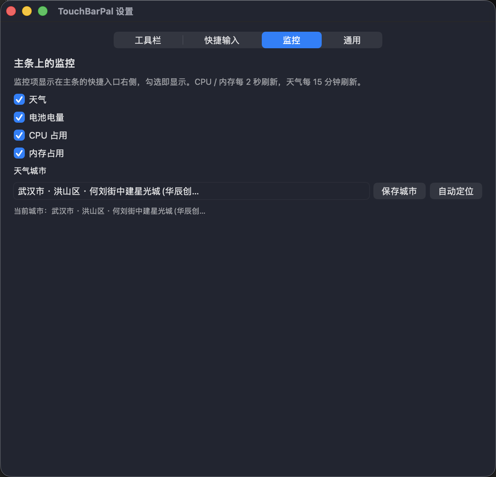
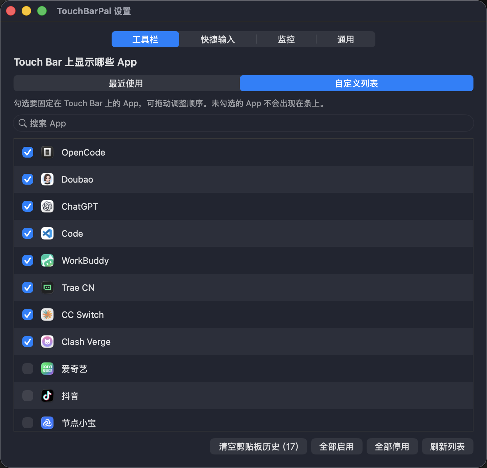

# TouchBarPal

[](../../releases/tag/v1.0)
[](#适配系统)
[-lightgrey.svg)](#从源码构建)
[](LICENSE)

给带 Touch Bar 的 Mac 增加一条常驻的全局工具条：**剪贴板历史**、**快捷输入**、**App 启动器**、**快捷键提示**、**系统监控**和一只会走动的宠物。

TouchBarPal 是菜单栏 App，运行时不在 Dock 留图标，只挂在状态栏。无论当前前台是谁，工具条都保持可见；点 `‹` 返回，点最左侧 `×` 收起。


> [下载 1.0 安装包](../../releases/tag/v1.0) · [安装说明](docs/INSTALL.md) · [从源码构建](docs/BUILDING.md) · [功能说明](docs/FEATURES.md)

---

## 功能

### 剪贴板历史

- 自动保存最近 40 条文本和图片（复制的图片文件也会转为缩略图），图片显示尺寸。
- 点任意一条立即粘贴到之前的 App；重复内容去重并置顶。
- 忽略密码管理器等标记为 `Concealed` / `Transient` / `AutoGenerated` 的内容。
- 一键清空历史。


### 快捷输入

- 在设置里维护常用短语，支持添加、编辑、删除、拖动排序。
- 点一条短语即输入到前台 App，可以连续点选多条。
- 适合客服话术、地址、邮箱、常用回复。


### App 启动器

- 自动扫描已安装的前台 App，跳过后台代理，不出现白图标。
- 点图标启动 App；已在运行则切换；已在前台再点一次收起。
- 运行中的 App 带绿点，最小化使用系统原生动画。
- 支持「最近使用」和可拖动排序的「自定义列表」两种模式。


### 快捷键提示

- 读取当前前台 App 的菜单栏快捷键，以 `⌘⇧N` 的形式横向展示。
- 点一下提示即执行对应菜单命令，不用真的按组合键。
- 结果缓存 20 秒，后台读取，不阻塞 Touch Bar。
- 需要辅助功能权限。


### 系统监控

- 天气、电池、CPU、内存逐项开关，显示在主条右侧。
- CPU / 内存每 2 秒刷新，天气每 15 分钟刷新，只在开启时计时。
- 天气可手动输入城市（精确到区/街道）或自动定位。



### 宠物与宠物墙

- 默认水豚会以顶层动画在条上走动、眨眼、挥手、打盹，点它有回应。
- 支持导入 Codex 格式的宠物精灵图（`pet.json` + 8 列、至少 9 行）。
- 宠物墙可横向浏览所有宠物，超出栏宽自动缓慢往返滚动，点格子即切换。


### 设置

- 工具栏、快捷输入、监控、通用四个标签页。
- 控制主条显示哪些 App、显示数量、监控开关、登录启动、辅助功能授权。
- 首次使用有权限引导和诊断信息。



---

## 适配系统

| 项目 | 要求 |
| --- | --- |
| macOS | **13.0 Ventura 及以上**（1.0 在 macOS 26.7.3 上完成验证） |
| 硬件 | 带 **Touch Bar** 的 MacBook Pro（2016–2022，Intel / Apple Silicon 均可） |
| 架构 | Universal 2，同时包含 `arm64` 与 `x86_64` |
| 显示模式 | Touch Bar 需处于「App Controls with Control Strip」 |
| 权限 | 自动粘贴与快捷键需要「辅助功能」；天气定位需要「定位服务」 |
| 签名 | 本地签名、未公证（见[已知限制](#已知限制)） |

没有 Touch Bar 的 Mac 可以安装并打开设置，但工具条没有硬件可以显示。

> Touch Bar 在 2022 款 13 英寸 MacBook Pro 之后停产；本项目面向仍在使用这类机器的用户。

---

## 安装 1.0

从 [Releases](../../releases/tag/v1.0) 下载：

- `TouchBarPal-1.0-universal.dmg`（推荐）
- `TouchBarPal-1.0-universal.zip`

打开 DMG，把 **TouchBarPal** 拖进「应用程序」，然后：

1. 首次启动如被 Gatekeeper 拦截，右键 App →「打开」，或执行：
   ```bash
   xattr -dr com.apple.quarantine /Applications/TouchBarPal.app
   ```
2. 在「系统设置 › 隐私与安全性 › 辅助功能」中勾选 TouchBarPal。
3. 在「隐私与安全性 › 定位服务」中按需授权。
4. 从状态栏菜单点「显示 Touch Bar 面板」。

完整步骤与卸载方法见 [docs/INSTALL.md](docs/INSTALL.md)。

### 校验下载

```bash
shasum -a 256 TouchBarPal-1.0-universal.dmg
# 与 Releases 页面公布的 SHA-256 对比
```

---

## 从源码构建

只需要 Command Line Tools（不需要完整 Xcode）：

```bash
git clone https://github.com/chenhao/TouchBarPal.git
cd TouchBarPal
./build.sh --universal   # 或 ./build.sh 只构建当前架构
open .build
```

产物是 `.build/TouchBarPal.app`。本地开发也可以用 `./install.sh` 直接安装到 `/Applications`。

自检（无需图形界面）：

```bash
./.build/TouchBarPal.app/Contents/MacOS/TouchBarPal --selftest
```

打包 1.0 发布物：

```bash
./tools/package.sh
```

更多环境要求、签名和调试方法见 [docs/BUILDING.md](docs/BUILDING.md)。

---

## 权限与隐私

- **辅助功能**：用于把剪贴板内容 / 短语输入到前台 App，以及读取和点击菜单快捷键。
- **定位服务**：只在你点「自动定位」时使用，保存经纬度和地名，不上传。
- 所有数据都在本地：设置和短语在 `UserDefaults`，剪贴板与图片在
  `~/Library/Application Support/TouchBarPal/`。
- 无账号、无统计上报。天气通过 [Open-Meteo](https://open-meteo.com/) 获取，
  只发送坐标，不发送设备或使用数据。

---

## 已知限制

- **全局 Touch Bar 依赖私有 API**
  `NSTouchBar.presentSystemModalTouchBar(_:placement:systemTrayItemIdentifier:)`，
  Pock / MTMR 等同类工具也使用它。系统大版本升级后可能失效。
- 因此 App 使用本地签名且未启用 hardened runtime，也无法通过 Mac App Store 分发。
- 未做 Apple 公证，首次打开需要右键打开或移除 quarantine 属性。
- 重新编译后如果自动粘贴失效，请在辅助功能中移除旧条目再重新勾选。
- 密码等敏感内容是否被记录，取决于来源 App 是否按惯例标记剪贴板类型。
- 快捷键提示读取的是菜单栏；没有菜单项的操作不会出现。

---

## 目录结构

```
Sources/
  main.swift               入口 / --selftest 分支
  AppDelegate.swift        状态栏菜单、权限提示
  TouchBarController.swift 主条与各页面的组装、切换
  MainBarView.swift        主条布局、监控 chip、宽度测量
  ChipButton.swift         自绘 chip（图标 + 文字子视图）
  Scrubbers.swift          剪贴板条目与 App 图标的 NSScrubber
  ShortcutReader.swift     辅助功能菜单读取与 AXPress
  ShortcutViews.swift      快捷键页
  ClipboardStore.swift     剪贴板监听、去重、持久化、粘贴
  QuickPhraseStore.swift   快捷短语存储与输入
  AppCatalog.swift         应用扫描、排序、过滤、启动
  AppSettings.swift        显示模式、隐藏列表、批量设置
  PetLibrary.swift         内置与导入宠物
  PetView.swift            宠物动画
  PetWallView.swift        宠物墙
  Monitors.swift           天气 / 电池 / CPU / 内存采样
  PreferencesWindowController.swift 设置窗口
  SelfTest.swift           无界面自检
Resources/
  Info.plist               LSUIElement 与版本信息
  spritesheet.webp         内置水豚精灵图
tools/
  make-icon.swift          生成 App 图标
  package.sh               生成 zip / dmg / SHA-256
docs/                      安装、构建、功能与截图
```

---

## 参与贡献

见 [CONTRIBUTING.md](CONTRIBUTING.md)。Bug 与功能请求请用 Issue 模板；提交前请先跑 `--selftest`。
发布流程见 [docs/PUBLISHING.md](docs/PUBLISHING.md)。

## 许可

[MIT](LICENSE)。内置水豚与示例宠物素材仅用于演示，请按其原始许可使用。
