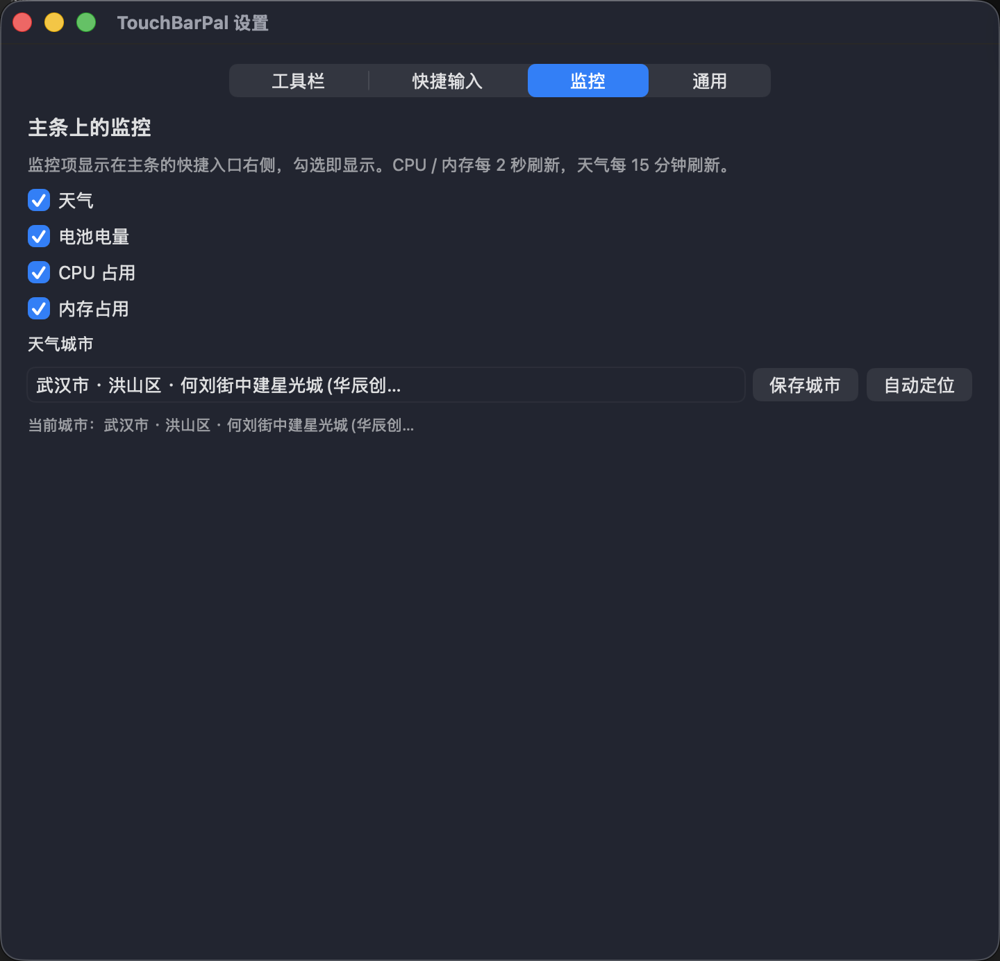
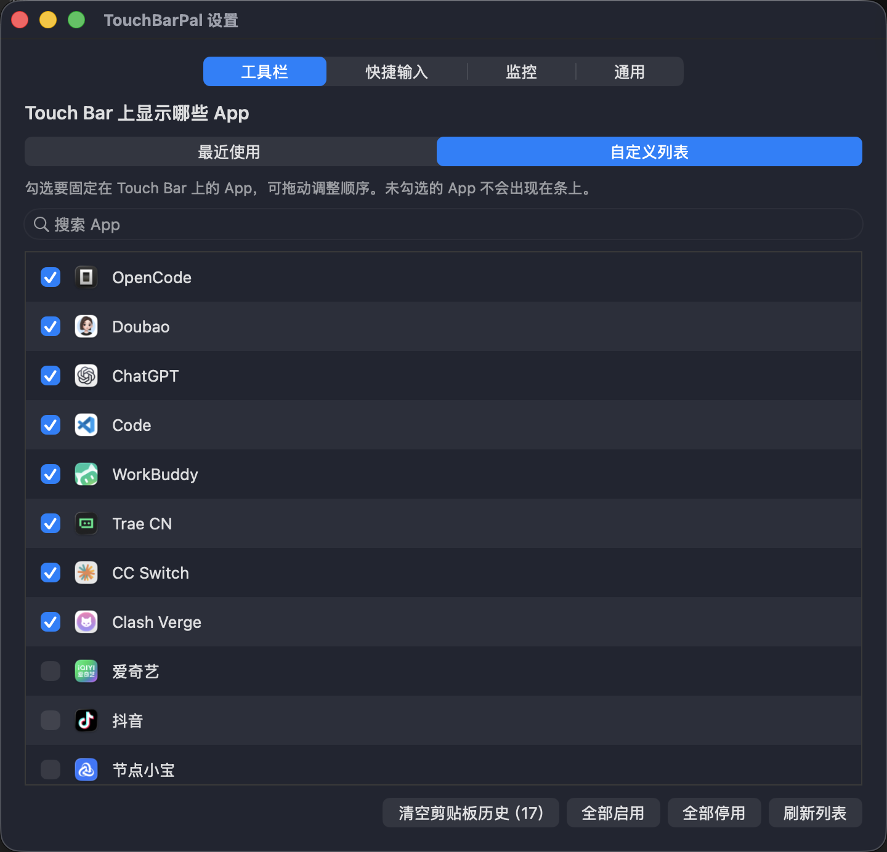

# 功能说明

TouchBarPal 1.0 的完整功能与使用方式。安装见 [INSTALL.md](INSTALL.md)。

主条从左到右：系统关闭 `×`、剪贴板、快捷输入、应用、快捷键、宠物墙、监控（按需）、最近 App、Control Strip。

- 点 `‹` 返回上一页。
- 点 `×` 只收起工具条，不退出 App；之后从状态栏菜单或 Control Strip 恢复。
- 所有页面都在前台 App 之上保持可见。

## 剪贴板历史

- 每 0.5 秒检查系统剪贴板，保存最近 40 条文本或图片（复制的图片文件会转为缩略图）。
- 图片条目显示缩略图、尺寸和「图片」标记。
- 点条目立即粘贴到之前的 App。
- 相同内容去重并提到最前。
- 右侧垃圾桶清空历史；空历史时显示占位说明。
- 忽略 `org.nspasteboard.ConcealedType`、`TransientType`、`AutoGeneratedType`。
- 文本在 `~/Library/Application Support/TouchBarPal/clipboard.json`，
  图片在 `ClipboardImages/`，单张上限 16 MB。

## 快捷输入

- 在设置 › 快捷输入中维护短语，支持添加、更新、删除、拖动排序。
- 点一条即输入到前台 App，使用辅助功能模拟键盘输入。
- 可以连续点选多条。
- 数据保存在 `UserDefaults` 的 `quickPhrases`。

## App 启动器

- 扫描 `/Applications`、`/System/Applications`、Cryptex 路径、`~/Applications`，并单独加入 Finder。
- 跳过 `LSUIElement` / `LSBackgroundOnly` 后台代理。
- 点图标：未运行则启动，已运行则切换，已在前台则最小化。
- 最小化使用系统原生窗口动画；运行中的 App 右下角有绿点。
- 设置 › 工具栏可切换「最近使用 / 自定义列表」、调整数量（1–14）、勾选可见 App。

## 快捷键提示

- 通过辅助功能读取前台 App 的菜单栏，展示 `⌘⇧N` 形式的提示。
- 点提示即用 `kAXPressAction` 执行菜单项，不需要真的按组合键。
- 跳过共享的 Apple 菜单，结果缓存 20 秒，在后台线程读取。
- 需要辅助功能授权；未授权时显示权限占位页。

## 系统监控

- 天气、电池、CPU、内存可逐项开关。
- CPU / 内存每 2 秒采样，天气每 15 分钟刷新，只在开启时计时。
- 天气可输入城市（支持区 / 街道）或自动定位；点击天气查看详情。
- 开启监控后会减少一个最近 App 槽位，避免图标被挤扁。

## 宠物与宠物墙

- 内置水豚，以顶层透明覆盖层在条上走动、眨眼、挥手或打盹。
- 点宠物有开心反馈。
- 宠物墙横向排列所有宠物；超出宽度时缓慢往返滚动，背景副本以 0.45 倍速度形成视差。
- 格子下方的圆点标记当前宠物，点格子即切换。
- 设置 › 通用可导入 Codex 格式宠物：`pet.json` + 8 列、至少 9 行的透明精灵图。
  第 1 行待机、第 2/3 行向右/向左走，其余为动作；兼容 11 行含舞蹈版本。

## 设置

四个标签页：

- **工具栏**：最近使用 / 自定义列表、搜索、勾选、排序、清空剪贴板、全部启用 / 停用、刷新列表。
- **快捷输入**：短语管理。
- **监控**：监控开关、天气城市、自动定位。
- **通用**：登录启动、辅助功能授权、宠物导入与选择、使用说明、诊断信息、自定义 Touch Bar。

设置变更会合并成一次重绘，连续快速勾选不会卡顿或留下残影。

## 状态栏菜单

- 打开设置…
- 显示 / 隐藏 Touch Bar 面板
- 退出

## 快捷键与手势

| 操作 | 结果 |
| --- | --- |
| 点 `×` | 收起工具条 |
| 点 `‹` | 返回上一页 |
| 点剪贴板条目 | 粘贴 |
| 点短语 | 输入 |
| 点 App 图标 | 启动 / 切换 / 最小化 |
| 点快捷键提示 | 执行菜单命令 |
| 点宠物 | 互动 |
| 点宠物墙格子 | 切换宠物 |
